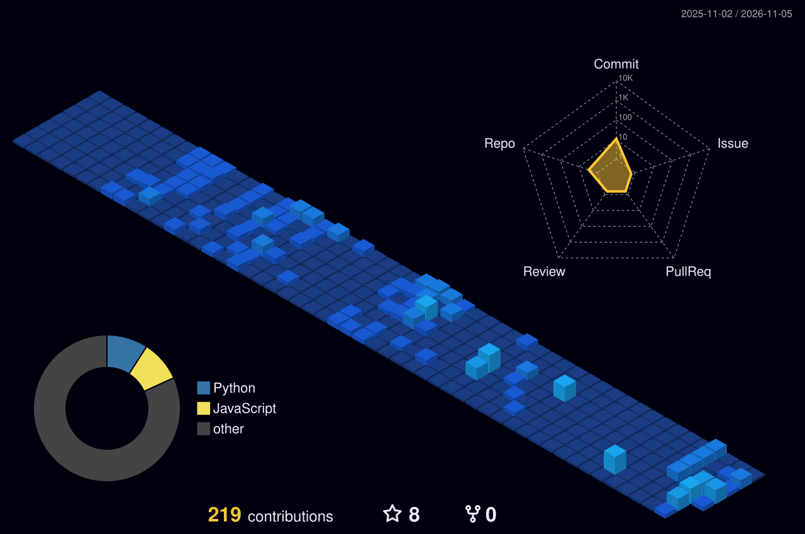

<h1 align="center">Hi, I'm Pallavi 👋</h1>

  <b>🗡️ Offensive security · 🔐 Post-quantum cryptography</b> 
  🎓 M.S. Computer Information Systems (Cybersecurity), Boston University · 📍 Boston, MA

  
  
  

---

🧩 I like building something and then trying to break it. Right now that means two things: **offensive security**, and **post-quantum cryptography** in real protocols, mainly how ML-KEM changed the TLS handshake.

### ⚡ Currently

- 🔬 **Research: Post-Quantum TLS & Bot Detection.** Do bot impersonation tools copy the post-quantum ClientHello correctly? I tested 288 disguises from 8 tools against real Chrome, Firefox and Safari. One X25519 check caught 46 of them and none of the 78 real browsers. [Read the study →](https://pallaviis.com/projects/pq-bot-fingerprint)
- 🛠️ **Building: Quietwire.** End-to-end encrypted chat with a post-quantum ML-KEM ratchet, running on Cloudflare Workers.
- 🧭 **Up next: Post-Quantum Benchmark Harness.** Measuring how post-quantum KEMs and signatures perform on small IoT devices.
- 🎯 Preparing for the **OSCP**.

### 🚀 Selected work

| Project | What it is |
| --- | --- |
| 🎯 [**RuleRecoil**](https://github.com/Pallavii-dev/RuleRecoil) | Detection engineering lab: replays attack telemetry against Sigma rules and fails when a detection stops firing or starts crying wolf. |
| 🛡️ [**SIEM home lab**](https://github.com/Pallavii-dev/siem-home-lab) | Wazuh server VM with a Windows agent, custom rules and detections, plus the design rationale. |
| ☁️ [**Azure SOC home lab**](https://pallaviis.com/projects/azure-soc-home-lab) | Microsoft Sentinel across 10+ telemetry sources, KQL detections mapped to MITRE ATT&CK. |
| 🔧 [**MITRE eCTF 2026**](https://pallaviis.com/projects/mitre-ectf-firmware-security) | Designed and attacked secure firmware on Arm Cortex-M0+. |

👉 More on [pallaviis.com](https://pallaviis.com/projects).

### 🧰 Toolkit

  

**🔐 Post-quantum & protocols** 

**🕵️ Bot & fingerprint research** 

**🗡️ Offensive & detection** 

**☁️ Cloudflare** 

### 📊 Contributions

  

💬 Always happy to talk security, PQC or a good CTF. Say hi at <a href="https://pallaviis.com/contact">pallaviis.com/contact</a> ✨

